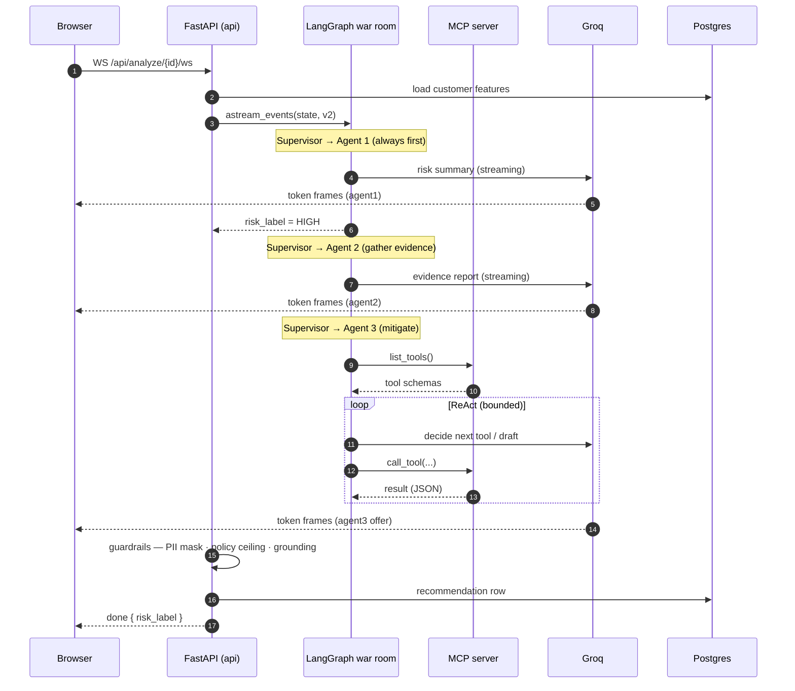
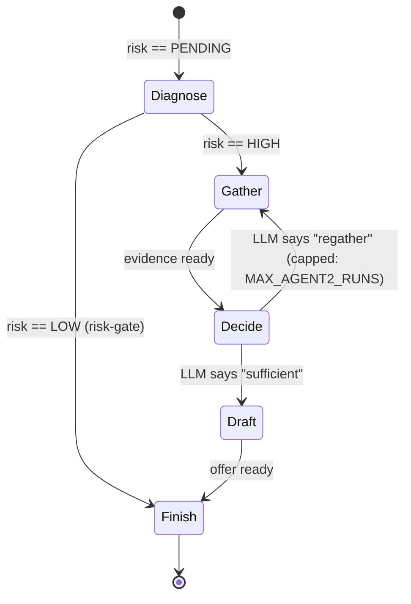
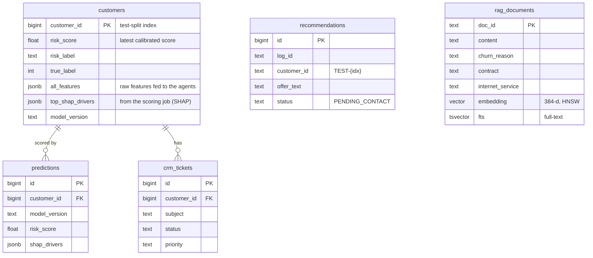
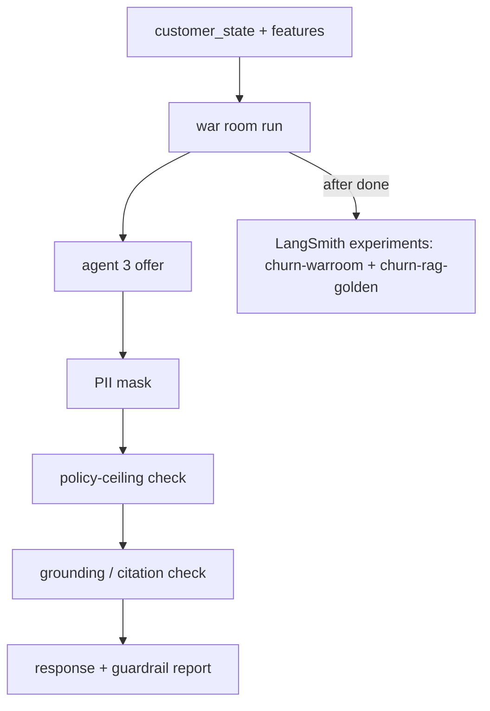

# Architecture

Deep-dive diagrams and design notes. For the overview, see the [README](../README.md).

## Request sequence (WebSocket analysis)

An end-to-end analysis, streamed token-by-token:

Low-risk customers short-circuit: the supervisor routes Agent 1 → **FINISH** and Agents 2/3 never run (the UI marks them *skipped*).

## Supervisor state machine

The supervisor is deterministic where the flow is linear and only asks the LLM at the one genuine decision — is the gathered evidence sufficient to draft, or gather once more?

A hard `MAX_STEPS` cap and the re-gather cap guarantee termination — a lesson learned in verification, where an unconstrained LLM router looped `agent2` five times until the cap.

## Data model

Postgres (Supabase in production, the pgvector container locally) with raw SQL — psycopg 3,
no ORM, blocking calls wrapped in `asyncio.to_thread`. Schema: `supabase/migrations/`, applied
by `supabase db push` in production and by the compose `db` container on first start. The API
writes recommendations; the MCP server only reads (CRM tools); batch jobs write scores.

`customers`, `predictions` and `crm_tickets` are written by `python -m churn_ml.scoring --seed`
(re-scoring alone: `python -m churn_ml.scoring`); `rag_documents` by `python -m churn_rag.pg_index`;
`recommendations` accumulate per war-room run. Row-level security is enabled on every table with no
policies, so Supabase's public REST API cannot read any of it.

## Safety & evaluation flow

- **Guardrails** run inline on the drafted offer for every request (both POST and WS paths) and never block hard (this is an internal analyst tool) — violations are flagged on the response.
- **Evals** run after every analysis, once the UI has its answer (`churn_evals/live.py`): the analysis is one LangSmith trace (`war-room · customer <id>`), and is recorded as an experiment on `churn-warroom` (routing, policy tool before offer, guardrails, citations, LLM-judge quality) and, for HIGH risk, on `churn-rag-golden` (recall / precision / nDCG @3/5/10, MRR, citation accuracy, LLM-judge faithfulness and relevance). The same customer always attaches to the same dataset example, so prompt versions are compared side by side. Best-effort: a no-op when tracing is off.

## Streaming internals

The WebSocket endpoint (`api/routes/ws.py`) drives `war_room_graph.astream_events(version="v2")` and translates the event stream into UI frames:

| LangGraph event | → WS frame |
|---|---|
| `on_chat_model_stream` (node ∈ agent1/2/3) | `{type: "token", agent, text}` |
| node `on_chain_end` | `{type: "agent_complete", agent, data}` |
| stream end | `{type: "done", risk_label, input_scan}` |

Only the three narrative agents stream tokens; the supervisor's structured-output routing and Agent 3's tool-deciding calls carry no useful text. The WebSocket is the war room's single entry point — there is no separate POST or SSE path.
